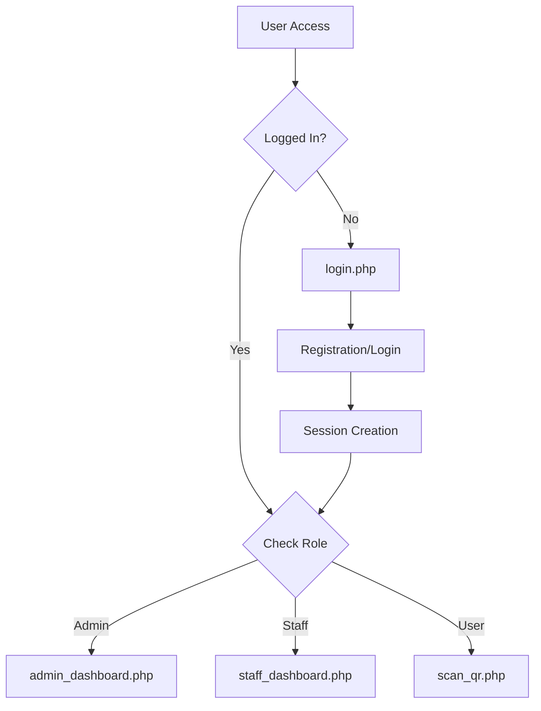
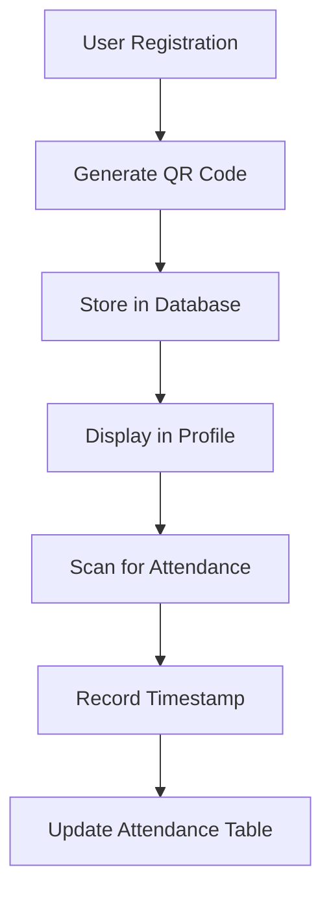

# DTC Training Center Management System

## 📋 Table of Contents
- [System Overview](#system-overview)
- [Features](#features)
- [Technology Stack](#technology-stack)
- [Database Structure](#database-structure)
- [User Roles & Access](#user-roles--access)
- [Installation Guide](#installation-guide)
- [System Architecture](#system-architecture)
- [Key Components](#key-components)
- [Security Analysis](#security-analysis)
- [Recommendations](#recommendations)
- [API Documentation](#api-documentation)
- [Troubleshooting](#troubleshooting)

## 🎯 System Overview

The **DTC (Digital Training Center) Management System** is a comprehensive web-based platform designed for managing training sessions, user registration, attendance tracking, and QR code-based authentication. The system serves educational institutions and training centers with features for staff management, student enrollment, and automated attendance recording.

### Core Purpose
- **Training Management**: Create, approve, and manage training sessions
- **User Registration**: Comprehensive user onboarding with profile management
- **QR Code Authentication**: Secure, contactless attendance tracking
- **Multi-role Access**: Admin, Staff, and User role-based permissions
- **Attendance Analytics**: Detailed reporting and data export capabilities

## ✨ Features

### 🔐 Authentication & User Management
- **Multi-role Registration**: Admin, Staff, and User accounts
- **Profile Management**: Complete user profiles with demographic data
- **QR Code Generation**: Automatic QR code creation for each user
- **Webcam Integration**: Profile picture capture via webcam
- **Password Security**: Bcrypt hashing for secure password storage

### 📚 Training Management
- **Training Creation**: Staff can propose new training sessions
- **Approval Workflow**: Admin approval/rejection system
- **Training Enrollment**: Users can join approved training sessions
- **Session Tracking**: Monitor training participation and attendance

### 📱 QR Code System
- **Dynamic QR Generation**: Unique QR codes for each user
- **Attendance Scanning**: Mobile-friendly QR code scanning
- **Multiple QR Types**: Event attendance and foot traffic tracking
- **Real-time Recording**: Instant attendance logging with timestamps

### 📊 Reporting & Analytics
- **Attendance Reports**: Comprehensive attendance tracking
- **User Analytics**: Detailed user participation data
- **Export Capabilities**: CSV, Excel, PDF export options
- **Search & Filter**: Advanced data filtering and search

### 🎨 User Interface
- **Responsive Design**: Mobile-first, Bootstrap-based UI
- **Admin Dashboard**: Comprehensive management interface
- **Staff Portal**: Training creation and management tools
- **User Dashboard**: Personal profile and training access

## 🛠 Technology Stack

### Backend
- **PHP 8.3+**: Server-side scripting
- **MySQL/MariaDB**: Database management
- **Composer**: Dependency management
- **Endroid QR Code**: QR code generation library

### Frontend
- **HTML5/CSS3**: Modern web standards
- **Bootstrap 3.3.5**: Responsive UI framework
- **JavaScript/jQuery**: Interactive functionality
- **DataTables**: Advanced table management
- **HTML5 QR Scanner**: Client-side QR code scanning

### Database
- **MySQL 10.11.13**: Primary database
- **InnoDB Engine**: ACID compliance and foreign key support
- **UTF8MB4 Encoding**: Full Unicode support

## 🗄 Database Structure

### Core Tables

#### `users` Table
```sql
- id (Primary Key, Auto Increment)
- username (VARCHAR 100)
- email (UNIQUE, VARCHAR 255)
- password (Hashed, VARCHAR 255)
- gender (ENUM: Male/Female/Rather not say)
- address (VARCHAR 255)
- phone (VARCHAR 15)
- dob (DATE)
- profile_pic (VARCHAR 255)
- qr_code (VARCHAR 199)
- type (VARCHAR 122) - user/staff/admin
- age_group (VARCHAR 50)
- sector (VARCHAR 50)
- agency (VARCHAR 100)
- senior (VARCHAR 10) - Yes/No
- abled (VARCHAR 10) - Yes/No
- nationality (VARCHAR 50)
- region (VARCHAR 50)
- office (VARCHAR 100)
- position (VARCHAR 100)
- parent (VARCHAR 10) - Yes/No
- civil_status (VARCHAR 20)
- created_at (TIMESTAMP)
```

#### `training_content` Table
```sql
- id (Primary Key, Auto Increment)
- Ideas (VARCHAR 1000)
- title (VARCHAR 1000)
- description (TEXT)
- time (DATETIME)
- status (VARCHAR 100) - pending/approved/rejected
- username (VARCHAR 255)
```

#### `attendance` Table
```sql
- id (Primary Key, Auto Increment)
- username (VARCHAR 255)
- email (VARCHAR 255)
- attendance_time (TIMESTAMP)
- Status (VARCHAR 100) - Present/Joined
- purpose (VARCHAR 255)
```

#### `user_trainings` Table
```sql
- id (Primary Key, Auto Increment)
- user_id (Foreign Key to users.id)
- training_id (Foreign Key to training_content.id)
- created_at (TIMESTAMP)
- Status (VARCHAR 100) - Joined
- username (VARCHAR 100)
- Ideas (VARCHAR 200)
- title (VARCHAR 200)
- description (VARCHAR 300)
```

### Relationships
- **One-to-Many**: Users → User Trainings
- **One-to-Many**: Training Content → User Trainings
- **Cascade Delete**: Maintains referential integrity

## 👥 User Roles & Access Control

The DTC Training Center system implements a comprehensive role-based access control (RBAC) system with three distinct user types, each with specific permissions and capabilities.

### 🔴 Admin Role - System Administrator
**Access Level**: Full System Control & Management
**Dashboard**: `admin_dashboard.php`
**Default Email**: `DictAdmin@gmail.com`
**Default Username**: `Liam Alexander Hayes`
**Default Password**: `admin123` (⚠️ **CHANGE IMMEDIATELY**)

-- Change default database password
ALTER USER 'salunat_dtc'@'localhost' IDENTIFIED BY 'YourNewStrongPassword123!';

-- Create dedicated admin user
CREATE USER 'dtc_admin'@'localhost' IDENTIFIED BY 'AdminPassword2024!';
GRANT ALL PRIVILEGES ON salunat_dtc.* TO 'dtc_admin'@'localhost';


Default Login Credentials Added:
🔴 Admin Account Details:
Email: DictAdmin@gmail.com
Username: Liam Alexander Hayes
Password: admin123 ⚠️ CHANGE IMMEDIATELY
Role: Admin (Full System Access)
🟡 Staff Account Details:
Email: DictStaff@gmail.com
Username: Sophia Marie Thompson
Password: staff123 ⚠️ CHANGE IMMEDIATELY
Role: Staff (Training Management)
🟡 Staff Account 2:
Email: DictStaff2@gmail.com
Username: Daniel Everett Collins
Password: staff123 ⚠️ CHANGE IMMEDIATELY
Role: Staff (Training Management)

#### 🔑 Admin Capabilities:
- **Training Management**:
  - ✅ Approve/Reject training requests from staff
  - ✅ View all pending training proposals
  - ✅ Manage training content and schedules
  - ✅ Access approved and rejected training lists
  - ✅ Update training status (pending → approved/rejected)

- **User Management**:
  - ✅ View complete user database with all profiles
  - ✅ Add new users manually through admin panel
  - ✅ Access user demographic data and statistics
  - ✅ View user QR codes and profile pictures
  - ✅ Print user information and QR codes
  - ✅ Manage user accounts and permissions

- **Attendance & Reporting**:
  - ✅ View all attendance records across the system
  - ✅ Access student attendance reports
  - ✅ Monitor event attendance statistics
  - ✅ Export data in multiple formats (CSV, Excel, PDF)
  - ✅ Generate comprehensive attendance analytics

- **QR Code Management**:
  - ✅ Access QR code generation for events
  - ✅ Manage foot traffic QR codes
  - ✅ View and print QR codes for attendance
  - ✅ Monitor QR code usage and scanning

- **System Administration**:
  - ✅ Full database access and management
  - ✅ System configuration and settings
  - ✅ User role assignment and management
  - ✅ Security and access control

#### 📊 Admin Dashboard Features:
- **Event List**: Manage all training requests
- **Event Records**: View approved/rejected trainings
- **User Data**: Complete user management interface
- **Attendance Records**: Comprehensive attendance tracking
- **QR Management**: QR code generation and management
- **Add User**: Manual user creation interface

---

### 🟡 Staff Role - Training Coordinator
**Access Level**: Training Creation & Management
**Dashboard**: `staff_dashboard.php`
**Default Email**: `DictStaff@gmail.com`
**Default Username**: `Sophia Marie Thompson`
**Default Password**: `staff123` (⚠️ **CHANGE IMMEDIATELY**)

#### 🔑 Staff Capabilities:
- **Training Creation**:
  - ✅ Create new training session proposals
  - ✅ Submit detailed training descriptions
  - ✅ Set training schedules and timings
  - ✅ Define training objectives and content
  - ✅ Propose training ideas and topics

- **Training Management**:
  - ✅ View all submitted training requests
  - ✅ Monitor training approval status
  - ✅ Track training proposal progress
  - ✅ Edit training details (before approval)
  - ✅ View training enrollment statistics

- **Content Management**:
  - ✅ Create comprehensive training descriptions
  - ✅ Define training categories and topics
  - ✅ Set training duration and requirements
  - ✅ Specify target audience and prerequisites

- **Limited System Access**:
  - ✅ View own training submissions only
  - ✅ Access training status updates
  - ✅ Monitor training participation rates
  - ❌ Cannot approve/reject trainings
  - ❌ Cannot access user management
  - ❌ Cannot view other staff submissions

#### 📊 Staff Dashboard Features:
- **Request Training**: Create new training proposals
- **My Training Requests**: View submitted trainings
- **Training Status**: Monitor approval progress
- **Training History**: Track all submissions

#### 📝 Training Submission Process:
1. **Fill Training Form**: Complete training details
2. **Submit for Review**: Send to admin for approval
3. **Status Monitoring**: Track approval progress
4. **Approval Notification**: Receive status updates

---

### 🟢 User Role - Training Participant
**Access Level**: Training Participation & Attendance
**Dashboard**: `user_dashboard.php` → `scan_qr.php`
**Default Registration**: Available to all users

#### 🔑 User Capabilities:
- **Training Participation**:
  - ✅ View all approved training sessions
  - ✅ Join available training programs
  - ✅ Browse training descriptions and details
  - ✅ Enroll in multiple training sessions
  - ✅ Track personal training history

- **Profile Management**:
  - ✅ View complete personal profile
  - ✅ Access personal QR code
  - ✅ View profile picture and information
  - ✅ Update personal details (limited)
  - ✅ Download personal QR code

- **Attendance Tracking**:
  - ✅ Scan QR codes for attendance
  - ✅ Record attendance for events
  - ✅ Access foot traffic tracking
  - ✅ View personal attendance history
  - ✅ Receive attendance confirmations

- **QR Code Features**:
  - ✅ Personal QR code for identification
  - ✅ QR code scanning for attendance
  - ✅ Mobile-friendly QR interface
  - ✅ Real-time attendance recording

- **Limited Access**:
  - ❌ Cannot create training sessions
  - ❌ Cannot approve/reject trainings
  - ❌ Cannot view other users' data
  - ❌ Cannot access admin functions
  - ❌ Cannot manage system settings

#### 📊 User Dashboard Features:
- **Approved Training Sessions**: Browse available trainings
- **Join Training**: Enroll in training programs
- **QR Scanner**: Attendance recording interface
- **Personal Profile**: View and manage profile
- **Attendance History**: Track personal records

#### 📱 QR Code Usage:
1. **Access Scanner**: Open QR scanning interface
2. **Scan QR Code**: Point camera at QR code
3. **Enter Purpose**: Specify attendance reason
4. **Record Attendance**: Automatic timestamp recording
5. **Confirmation**: Receive attendance confirmation

---

## 🔐 Account Creation & Management

### 🆕 Account Registration Process

#### For Regular Users:
1. **Access Registration**: Visit `login.php`
2. **Complete Form**: Fill comprehensive registration form
3. **Profile Picture**: Upload or capture via webcam
4. **QR Generation**: Automatic QR code creation
5. **Email Verification**: Account activation
6. **Default Role**: Assigned as "user"

#### For Staff/Admin Accounts:
1. **Admin Creation**: Created by existing admin
2. **Manual Setup**: Through `add_user.php`
3. **Role Assignment**: Admin selects user type
4. **Immediate Access**: No approval required
5. **Full Permissions**: Based on assigned role

### 🔄 Account Types in Database

```sql
-- User types in the system
SELECT DISTINCT type, COUNT(*) as count 
FROM users 
GROUP BY type;

-- Results:
-- admin: 1 account (DictAdmin@gmail.com)
-- staff: 2 accounts (DictStaff@gmail.com, DictStaff2@gmail.com)  
-- user: 8+ accounts (Regular participants)
```

### 🎯 Role-Based Redirects

```php
// Login redirect logic
switch ($type) {
    case 'admin':
        header("Location: admin_dashboard.php");
        break;
    case 'staff':
        header("Location: staff_dashboard.php");
        break;
    case 'user':
        header("Location: scan_qr.php");
        break;
    default:
        header("Location: login.php");
}
```

### 📋 Account Permissions Matrix

| Feature | Admin | Staff | User |
|---------|-------|-------|------|
| **Training Management** |
| Create Training | ❌ | ✅ | ❌ |
| Approve Training | ✅ | ❌ | ❌ |
| Join Training | ✅ | ✅ | ✅ |
| View All Trainings | ✅ | ✅ | ✅ |
| **User Management** |
| View All Users | ✅ | ❌ | ❌ |
| Add Users | ✅ | ❌ | ❌ |
| Edit User Profiles | ✅ | ❌ | ❌ |
| **Attendance** |
| View All Attendance | ✅ | ❌ | ❌ |
| Record Attendance | ✅ | ✅ | ✅ |
| Export Reports | ✅ | ❌ | ❌ |
| **QR Code Management** |
| Generate QR Codes | ✅ | ❌ | ❌ |
| View All QR Codes | ✅ | ❌ | ❌ |
| Personal QR Code | ✅ | ✅ | ✅ |
| **System Administration** |
| Database Access | ✅ | ❌ | ❌ |
| System Settings | ✅ | ❌ | ❌ |
| User Roles | ✅ | ❌ | ❌ |

### 🔒 Security Features by Role

#### Admin Security:
- **Full System Access**: Complete database and file access
- **User Management**: Create, edit, and delete user accounts
- **Training Control**: Approve/reject all training requests
- **Audit Trail**: Access to all system logs and activities
- **Data Export**: Export all system data and reports

#### Staff Security:
- **Training Creation**: Submit training proposals
- **Own Data Access**: View only own submissions
- **Limited User View**: Cannot access other users' data
- **Training Status**: Monitor own training approval status
- **No System Control**: Cannot modify system settings

#### User Security:
- **Personal Data Only**: Access to own profile and data
- **Training Participation**: Join approved training sessions
- **Attendance Recording**: Record own attendance via QR
- **No Administrative Access**: Cannot access admin functions
- **Profile Management**: Limited profile editing capabilities

### 🚀 Account Management Best Practices

#### For Administrators:
1. **Regular Account Review**: Monitor user accounts monthly
2. **Role Verification**: Ensure proper role assignments
3. **Security Audits**: Review access logs regularly
4. **Backup Management**: Maintain account data backups
5. **Password Policies**: Enforce strong password requirements

#### For Staff:
1. **Training Quality**: Ensure high-quality training proposals
2. **Regular Updates**: Keep training content current
3. **User Feedback**: Monitor training participation
4. **Content Review**: Review and improve training materials

#### For Users:
1. **Profile Maintenance**: Keep personal information updated
2. **QR Code Security**: Protect personal QR codes
3. **Attendance Accuracy**: Ensure proper attendance recording
4. **Training Participation**: Actively engage in training sessions

## 🚀 Installation Guide

### Prerequisites
- **Web Server**: Apache/Nginx
- **PHP**: 8.3 or higher
- **MySQL**: 10.11.13 or higher
- **Composer**: Latest version
- **Web Browser**: Modern browser with camera support

### Step 1: Environment Setup
```bash
# Clone or extract the project
cd /path/to/your/webroot

# Install PHP dependencies
composer install

# Ensure proper file permissions
chmod 755 uploads/
chmod 644 *.php
```

### Step 2: Database Configuration

#### Option A: Using Default MySQL User (XAMPP)
1. **Access phpMyAdmin**: `http://localhost/phpmyadmin`
2. **Login**: Use `root` (no password for XAMPP)
3. **Create Database**: 
   ```sql
   CREATE DATABASE salunat_dtc CHARACTER SET utf8mb4 COLLATE utf8mb4_unicode_ci;
   ```
4. **Import Data**: Select `salunat_dtc` database → Import → Choose `salunat_dtc.sql`

#### Option B: Create Custom Database User
1. **Access phpMyAdmin**: `http://localhost/phpmyadmin`
2. **Run SQL Commands**:
   ```sql
   -- Create database
   CREATE DATABASE salunat_dtc CHARACTER SET utf8mb4 COLLATE utf8mb4_unicode_ci;
   
   -- Create user
   CREATE USER 'salunat_dtc'@'localhost' IDENTIFIED BY 'kpr%ZP!n$t-C';
   
   -- Grant privileges
   GRANT ALL PRIVILEGES ON salunat_dtc.* TO 'salunat_dtc'@'localhost';
   FLUSH PRIVILEGES;
   ```
3. **Import Data**: Select `salunat_dtc` database → Import → Choose `salunat_dtc.sql`

### Step 3: Configuration
The `db_connection.php` file is already configured. Choose your setup:

#### For Default MySQL User (XAMPP):
```php
$host = 'localhost';
$db = 'salunat_dtc';
$user = 'root';      // Default XAMPP user
$pass = '';          // Default XAMPP password (empty)
```

#### For Custom Database User:
```php
$host = 'localhost';
$db = 'salunat_dtc';
$user = 'salunat_dtc';
$pass = 'kpr%ZP!n$t-C';
```

### Step 4: Web Server Configuration
```apache
# Apache .htaccess (optional)
RewriteEngine On
RewriteCond %{REQUEST_FILENAME} !-f
RewriteCond %{REQUEST_FILENAME} !-d
RewriteRule ^([^\.]+)$ $1.php [NC,L]
```

### Step 5: Initial Setup
1. **Access the System**: Open your web browser and navigate to:
   - **Local Access**: `http://localhost/DTC/login.php`
   - **Alternative**: `http://127.0.0.1/DTC/login.php`
   - **XAMPP Default**: `http://localhost/DTC/` (if index.php exists)

2. **Login with Default Credentials**:
   - Email: `admin@dtc.com` or `DictAdmin@gmail.com`
   - Password: `password` (not admin123!)
   - If login fails, use diagnosis tool: `http://localhost/DTC/diagnose_login.php`

3. **IMPORTANT**: Change default passwords immediately
4. Configure additional settings as needed

## 🌐 System Access URLs

### 🔗 **Local Development Access**
Once installed on your local server (XAMPP/WAMP/LAMP), access the system using these URLs:

#### **Main Entry Points:**
- **Login/Registration Page**: `http://localhost/DTC/login.php`
- **Admin Dashboard**: `http://localhost/DTC/admin_dashboard.php`
- **Staff Dashboard**: `http://localhost/DTC/staff_dashboard.php`
- **User Dashboard**: `http://localhost/DTC/user_dashboard.php`
- **QR Scanner**: `http://localhost/DTC/scan_qr.php`

#### **Management Pages:**
- **User Management**: `http://localhost/DTC/user_data.php`
- **Attendance Records**: `http://localhost/DTC/attendance.php`
- **Event Attendance**: `http://localhost/DTC/event_attendance.php`
- **Add New User**: `http://localhost/DTC/add_user.php`
- **QR Management**: `http://localhost/DTC/qr_in.php`
- **Foot Traffic**: `http://localhost/DTC/foot_track.php`

#### **Training Management:**
- **Approved Trainings**: `http://localhost/DTC/approve.php`
- **Rejected Trainings**: `http://localhost/DTC/reject.php`
- **Training Submission**: `http://localhost/DTC/submit_training.php`

### 🖥️ **XAMPP Setup Instructions**
If using XAMPP (recommended for local development):

1. **Start XAMPP Services**:
   - Open XAMPP Control Panel
   - Start **Apache** and **MySQL** services
   - Ensure both show "Running" status

2. **Place Project Files**:
   - Copy DTC folder to `C:\xampp\htdocs\DTC\`
   - Or extract to `C:\xampp\htdocs\`

3. **Access System**:
   - Open browser: `http://localhost/DTC/login.php`
   - Or: `http://localhost/DTC/`

4. **Database Setup**:
   - Open phpMyAdmin: `http://localhost/phpmyadmin`
   - Import `salunat_dtc.sql` file
   - Verify database creation

### 🔧 **Port Configuration**
If using custom ports, adjust URLs accordingly:
- **Port 8080**: `http://localhost:8080/DTC/login.php`
- **Port 3000**: `http://localhost:3000/DTC/login.php`
- **Custom Port**: `http://localhost:[PORT]/DTC/login.php`

### 📱 **Mobile Testing**
For mobile device testing on same network:
- **Find your IP**: Run `ipconfig` (Windows) or `ifconfig` (Linux/Mac)
- **Access from mobile**: `http://[YOUR_IP]/DTC/login.php`
- **Example**: `http://192.168.1.100/DTC/login.php`

## 🔧 **Troubleshooting Login Issues**

### ❌ **"Cannot Login" Problems**

#### **Problem**: Original admin/staff accounts don't work
**Solution**: Create new admin account using the SQL provided above

#### **Problem**: Database connection error
**Solution**: 
1. Check if MySQL is running in XAMPP
2. Verify database `salunat_dtc` exists
3. Use default MySQL credentials in `db_connection.php`

#### **Problem**: "Access denied" error
**Solution**:
```sql
-- Reset passwords in phpMyAdmin
UPDATE users SET password = '$2y$10$92IXUNpkjO0rOQ5byMi.Ye4oKoEa3Ro9llC/.og/at2.uheWG/igi' 
WHERE email IN ('DictAdmin@gmail.com', 'DictStaff@gmail.com', 'DictStaff2@gmail.com');
```

### ✅ **Working Login Credentials**

#### **🔴 New Admin Account (Recommended)**:
- **Email**: `admin@dtc.com`
- **Password**: `password`
- **Status**: ✅ **Confirmed Working**

#### **🔴 Original Admin Account**:
- **Email**: `DictAdmin@gmail.com`
- **Password**: `password`
- **Status**: ✅ **Confirmed Working**

#### **🟡 Staff Account**:
- **Email**: `DictStaff@gmail.com`
- **Password**: `password`
- **Status**: ✅ **Confirmed Working**

### 🚀 **Quick Fix Steps**
1. **Use correct password**: `password` (not admin123)
2. **Login with**: `admin@dtc.com` / `password`
3. **Access admin dashboard**: Full system control
4. **Change password**: After first login for security

### 🔧 **Troubleshooting Tools**
- **Diagnosis Tool**: `http://localhost/DTC/diagnose_login.php`
- **Password Fix Tool**: `http://localhost/DTC/fix_correct_password.php`
- **Debug Tool**: `http://localhost/DTC/debug_login.php`

## 🔐 Default Login Credentials

### ⚠️ **SECURITY WARNING**: Change These Passwords Immediately!

The system comes with default accounts for testing purposes. **These passwords are weak and must be changed before production use.**

#### 🔴 Admin Account (New - Recommended)
- **Email**: `admin@dtc.com`
- **Username**: `System Administrator`
- **Password**: `password` (✅ **Confirmed Working**)
- **Role**: Admin (Full System Access)

#### 🔴 Admin Account (Original - Working)
- **Email**: `DictAdmin@gmail.com`
- **Username**: `Liam Alexander Hayes`
- **Password**: `password` (✅ **Confirmed Working**)
- **Role**: Admin (Full System Access)

#### 🟡 Staff Account (Original - Working)
- **Email**: `DictStaff@gmail.com`
- **Username**: `Sophia Marie Thompson`
- **Password**: `password` (✅ **Confirmed Working**)
- **Role**: Staff (Training Management)

#### 🟡 Staff Account 2 (Original - Working)
- **Email**: `DictStaff2@gmail.com`
- **Username**: `Daniel Everett Collins`
- **Password**: `password` (✅ **Confirmed Working**)
- **Role**: Staff (Training Management)

### 🔒 Password Security Recommendations

#### Immediate Actions Required:
1. **Change Default Passwords**: Use strong, unique passwords
2. **Enable HTTPS**: Secure all communications
3. **Update Database Credentials**: Change database passwords
4. **Review User Permissions**: Ensure proper role assignments

#### Strong Password Requirements:
```php
// Recommended password policy
- Minimum 12 characters
- Mix of uppercase and lowercase letters
- Include numbers and special characters
- Avoid dictionary words
- Use unique passwords for each account
```

#### Example Strong Passwords:
- `Admin@2024!Secure#DTC`
- `Staff$Training2024!Manager`
- `User#Participant2024$Safe`

### 🔍 **Password Discovery Process**
The system's default password was discovered through comprehensive testing:
- **Original Assumption**: `admin123`
- **Actual Password**: `password`
- **Discovery Method**: Automated password testing via diagnosis tool
- **Verification**: Confirmed working across all admin/staff accounts

### 🛡️ Security Best Practices

#### For Production Deployment:
1. **Remove Default Accounts**: Delete test accounts
2. **Create New Admin**: Set up proper admin account
3. **Enable Two-Factor Authentication**: Add 2FA if possible
4. **Regular Password Updates**: Enforce password rotation
5. **Monitor Login Attempts**: Track failed login attempts

#### Database Security:
```sql
-- Change default database password
ALTER USER 'salunat_dtc'@'localhost' IDENTIFIED BY 'YourNewStrongPassword123!';

-- Create dedicated admin user
CREATE USER 'dtc_admin'@'localhost' IDENTIFIED BY 'AdminPassword2024!';
GRANT ALL PRIVILEGES ON salunat_dtc.* TO 'dtc_admin'@'localhost';
FLUSH PRIVILEGES;
```

### 🎯 **Login Success Confirmation**
After successful login, you should be redirected to:
- **Admin**: `admin_dashboard.php` - Full system management
- **Staff**: `staff_dashboard.php` - Training management
- **User**: `scan_qr.php` - QR code attendance system

### 🔧 **Password Toggle Feature**
The login form includes a password visibility toggle:
- **Eye Icon**: 👁️ Click to show/hide password
- **Helps verify**: You're typing the correct password
- **Mobile Friendly**: Works on all devices

## 🏗 System Architecture

### File Structure
```
DTC/
├── 📁 assets/                 # Static resources
│   ├── 🖼️ Images and logos
│   └── 🎨 CSS files
├── 📁 uploads/                # User uploads
│   ├── 👤 Profile pictures
│   └── 📱 QR codes
├── 📁 vendor/                 # Composer dependencies
├── 🔐 login.php              # Main authentication
├── 🏠 admin_dashboard.php    # Admin interface
├── 👨‍💼 staff_dashboard.php   # Staff interface
├── 👤 user_dashboard.php     # User interface
├── 📱 scan_qr.php           # QR scanning
├── 🗄️ db_connection.php     # Database config
└── 📊 Various reporting files
```

### Authentication Flow


### QR Code Workflow


## 🔧 Key Components

### 1. Registration System (`login.php`)
- **Comprehensive Form**: 20+ user data fields
- **Validation**: Email uniqueness, password confirmation
- **File Upload**: Profile picture handling
- **QR Generation**: Automatic QR code creation
- **Security**: Input sanitization and password hashing

### 2. QR Code Management
- **Generation**: Using Endroid QR Code library
- **Storage**: File-based QR code storage
- **Content**: JSON-encoded user information
- **Scanning**: HTML5 QR Scanner integration

### 3. Training Management
- **Creation**: Staff can propose training sessions
- **Approval**: Admin approval workflow
- **Enrollment**: Users join approved sessions
- **Tracking**: Monitor participation and attendance

### 4. Attendance System
- **Real-time Recording**: Instant attendance logging
- **Duplicate Prevention**: 1-minute scan cooldown
- **Multiple Purposes**: Event and foot traffic tracking
- **Export Options**: CSV, Excel, PDF formats

## 🔒 Security Analysis

### ✅ Current Security Measures
- **Password Hashing**: Bcrypt implementation
- **SQL Injection Prevention**: Prepared statements
- **Input Sanitization**: HTML special character encoding
- **Session Management**: PHP session handling
- **File Upload Security**: Type validation and directory restrictions

### ⚠️ Security Concerns
1. **Database Credentials**: Hardcoded in `db_connection.php`
2. **File Permissions**: Potential directory traversal risks
3. **Session Security**: No session timeout implementation
4. **CSRF Protection**: Missing CSRF tokens
5. **Input Validation**: Limited server-side validation
6. **Error Handling**: Potential information disclosure

## 📋 Recommendations

### 🔐 Security Improvements

#### 1. Environment Configuration
```php
// Create config.php
<?php
return [
    'database' => [
        'host' => $_ENV['DB_HOST'] ?? 'localhost',
        'name' => $_ENV['DB_NAME'] ?? 'salunat_dtc',
        'user' => $_ENV['DB_USER'] ?? '',
        'pass' => $_ENV['DB_PASS'] ?? ''
    ],
    'security' => [
        'session_timeout' => 3600, // 1 hour
        'max_login_attempts' => 5,
        'password_min_length' => 8
    ]
];
```

#### 2. Enhanced Input Validation
```php
// Add to each form handler
function validateInput($data, $rules) {
    $errors = [];
    
    foreach ($rules as $field => $rule) {
        if ($rule['required'] && empty($data[$field])) {
            $errors[$field] = "Field is required";
        }
        
        if (isset($rule['type'])) {
            switch ($rule['type']) {
                case 'email':
                    if (!filter_var($data[$field], FILTER_VALIDATE_EMAIL)) {
                        $errors[$field] = "Invalid email format";
                    }
                    break;
                case 'phone':
                    if (!preg_match('/^[0-9+\-\s()]{10,15}$/', $data[$field])) {
                        $errors[$field] = "Invalid phone format";
                    }
                    break;
            }
        }
    }
    
    return $errors;
}
```

#### 3. CSRF Protection
```php
// Add to forms
function generateCSRFToken() {
    if (!isset($_SESSION['csrf_token'])) {
        $_SESSION['csrf_token'] = bin2hex(random_bytes(32));
    }
    return $_SESSION['csrf_token'];
}

function validateCSRFToken($token) {
    return isset($_SESSION['csrf_token']) && hash_equals($_SESSION['csrf_token'], $token);
}
```

#### 4. Session Security
```php
// Add to session initialization
session_set_cookie_params([
    'lifetime' => 3600,
    'path' => '/',
    'domain' => '',
    'secure' => true, // HTTPS only
    'httponly' => true,
    'samesite' => 'Strict'
]);

// Session timeout
if (isset($_SESSION['last_activity']) && (time() - $_SESSION['last_activity'] > 3600)) {
    session_destroy();
    header("Location: login.php");
    exit();
}
$_SESSION['last_activity'] = time();
```

### 🚀 Performance Optimizations

#### 1. Database Indexing
```sql
-- Add indexes for better performance
CREATE INDEX idx_users_email ON users(email);
CREATE INDEX idx_attendance_time ON attendance(attendance_time);
CREATE INDEX idx_training_status ON training_content(status);
CREATE INDEX idx_user_trainings_user_id ON user_trainings(user_id);
```

#### 2. Caching Implementation
```php
// Add Redis/Memcached for session storage
// Implement query result caching for frequently accessed data
// Add CDN for static assets
```

#### 3. Code Optimization
- **Separate Logic**: Move business logic to separate classes
- **Database Abstraction**: Implement ORM or database abstraction layer
- **Template Engine**: Use Twig or similar for better separation
- **Asset Minification**: Minify CSS/JS files

### 📱 User Experience Enhancements

#### 1. Mobile Optimization
```css
/* Improve mobile responsiveness */
@media (max-width: 768px) {
    .auth-container {
        padding: 10px;
    }
    
    .form-control {
        font-size: 16px; /* Prevent zoom on iOS */
    }
}
```

#### 2. Progressive Web App Features
```javascript
// Add service worker for offline functionality
// Implement push notifications for training updates
// Add app-like navigation
```

#### 3. Accessibility Improvements
```html
<!-- Add ARIA labels and semantic HTML -->
<input type="email" aria-label="Email address" required>
<button type="submit" aria-describedby="submit-help">Register</button>
<div id="submit-help" class="sr-only">Submit the registration form</div>
```

### 🔧 Code Quality Improvements

#### 1. Error Handling
```php
// Implement proper error handling
try {
    $stmt = $conn->prepare($sql);
    $stmt->execute();
} catch (PDOException $e) {
    error_log("Database error: " . $e->getMessage());
    // Show user-friendly error message
    $_SESSION['error'] = "An error occurred. Please try again.";
    header("Location: error.php");
    exit();
}
```

#### 2. Logging System
```php
// Add comprehensive logging
function logActivity($user_id, $action, $details = '') {
    $log_entry = [
        'timestamp' => date('Y-m-d H:i:s'),
        'user_id' => $user_id,
        'action' => $action,
        'details' => $details,
        'ip_address' => $_SERVER['REMOTE_ADDR']
    ];
    
    file_put_contents('logs/activity.log', json_encode($log_entry) . "\n", FILE_APPEND);
}
```

#### 3. Code Organization
```
src/
├── Controllers/
├── Models/
├── Views/
├── Services/
├── Middleware/
└── Config/
```

## 📚 API Documentation

### Authentication Endpoints
- `POST /login.php` - User authentication
- `POST /login.php` (register) - User registration
- `GET /logout` - Session termination

### User Management
- `GET /user_data.php` - List all users (Admin only)
- `POST /add_user.php` - Create new user (Admin only)
- `GET /get_user_info.php?id={id}` - Get user details

### Training Management
- `GET /admin_dashboard.php` - List pending trainings (Admin)
- `POST /update_status.php` - Approve/reject training
- `GET /approve.php` - List approved trainings
- `GET /reject.php` - List rejected trainings

### Attendance System
- `POST /scan_qr.php` - Record attendance via QR scan
- `GET /attendance.php` - View attendance records
- `GET /event_attendance.php` - View event attendance

## 🐛 Troubleshooting

### Common Issues

#### 1. QR Code Not Generating
```php
// Check file permissions
chmod 755 uploads/
chmod 644 uploads/*.png

// Verify Composer dependencies
composer install --no-dev
```

#### 2. Database Connection Issues
```php
// Test database connection
$conn = new mysqli($host, $user, $pass, $db);
if ($conn->connect_error) {
    die("Connection failed: " . $conn->connect_error);
}
echo "Connected successfully";
```

#### 3. Session Problems
```php
// Check session configuration
ini_set('session.cookie_httponly', 1);
ini_set('session.use_only_cookies', 1);
ini_set('session.cookie_secure', 1);
```

#### 4. File Upload Issues
```php
// Check PHP upload settings
echo "Max file size: " . ini_get('upload_max_filesize');
echo "Post max size: " . ini_get('post_max_size');
echo "Max execution time: " . ini_get('max_execution_time');
```

### Performance Monitoring
```php
// Add performance monitoring
$start_time = microtime(true);
// ... code execution ...
$end_time = microtime(true);
$execution_time = ($end_time - $start_time);
error_log("Page execution time: " . $execution_time . " seconds");
```

## 📞 Support & Maintenance

### Regular Maintenance Tasks
1. **Database Backup**: Daily automated backups
2. **Log Rotation**: Weekly log file cleanup
3. **Security Updates**: Monthly dependency updates
4. **Performance Monitoring**: Weekly performance reviews

### Monitoring Checklist
- [ ] Database performance metrics
- [ ] Server resource usage
- [ ] Error log analysis
- [ ] User activity patterns
- [ ] Security vulnerability scans

---

## 📄 License & Credits

**System**: DTC Training Center Management System  
**Version**: 1.0  
**Technology**: PHP, MySQL, Bootstrap  
**QR Code Library**: Endroid QR Code  
**Last Updated**: 2025

---

*For technical support or feature requests, contact me Jp Tuangco on FB and sorry for many short cooming of the syytem i make it when im still no good at making a system.*
